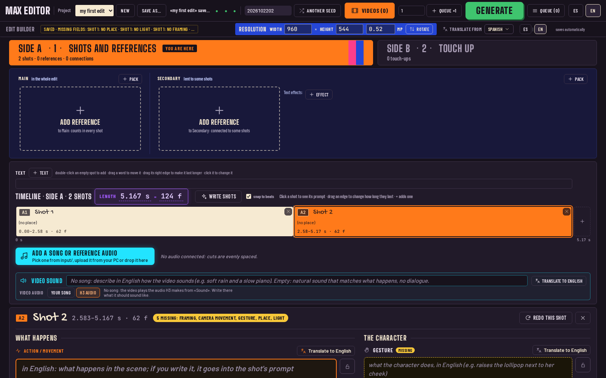
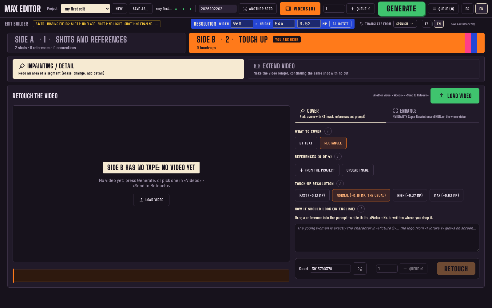

# MAX EDITOR

**AI music edits with MiniMax H3, on your own PC.** · Versión en español: [app/LEEME.md](app/LEEME.md)

- MAX EDITOR makes vertical music edits with **MiniMax H3**, fully local, with no paid services.
- You write an idea and pick your references and the part of the song. A **local LLM** writes the story and the shots, and code places the timing on the beats.
- You press **Generate**: the app sends the workflow to your ComfyUI through the **official Comfy SDK** and shows you the video.



<details><summary>Step 2: Touch up (redo a zone of a video, enhance it or extend it)</summary>



</details>

## What's in this repo

| Folder / file | What it is |
|---|---|
| [`app/`](app/) | **MAX EDITOR**, the app: web page, server, Comfy SDK calls, MCP server, installer and the ComfyUI workflows it runs (`app/plantillas/*.api.json`) |
| [`web/`](web/), `nucleo.py`, `rutas.py`, `frases.json` | the edit editor and the prompt logic, shared by the app and by the ComfyUI node |
| `__init__.py`, `locales/`, [`workflows/`](workflows/) | the same editor as a ComfyUI custom node, with an example workflow |
| [`runpod/`](runpod/), [RUNPOD.md](RUNPOD.md) | the RunPod template: the whole app on a rented GPU |
| [MODELOS.md](MODELOS.md), [CREDITOS.md](CREDITOS.md), [REPRODUCE.md](REPRODUCE.md) | models, credits and licenses, step-by-step install check |
| `pruebas.py`, `pruebas/` | tests (`python pruebas.py`) |
| [`planos/`](planos/), [PLANOS.md](PLANOS.md), PRODUCT.md, `.impeccable/` | developer notes and design contract (in Spanish) |

## Install

> **You need:** Linux, an NVIDIA GPU with 12 GB, a working [ComfyUI](https://docs.comfy.org/installation) v0.39.0 or newer, about 70 GB of disk and 64 GB of RAM + swap.
> **Don't have that, or don't know ComfyUI?** Use the **[RunPod template](RUNPOD.md)**: it sets up everything and you only use the app.

Pick one of three ways. All three run the same installer, `app/instalar.sh`, which reads one parts list ([app/instalacion/comfy-build.yaml](app/instalacion/comfy-build.yaml)):
- it puts **10 node packs** in `ComfyUI/custom_nodes/`, each at the exact commit we tested, and never overwrites a pack you already have;
- it installs their Python dependencies into ComfyUI's Python with **torch, torchvision, torchaudio and numpy frozen**;
- it downloads the **models from HuggingFace** (resumable, each **sha256** checked) **only if you say yes**. You can also pick models you already have, or download them later with one click, in the app › **🧩 Models**;
- it never patches ComfyUI itself, and it can be run again: what is already there is skipped.

### 1. One command (Linux)

```
git clone https://github.com/xentome/EDITS-WITH-AI.git && cd EDITS-WITH-AI && app/instalar.sh --comfyui ~/ComfyUI --retocar
```

Then start (or restart) ComfyUI and run `app/arrancar.sh`: the app opens at `http://127.0.0.1:8300`.

| Option | What it does |
|---|---|
| `--comfyui DIR` | where your ComfyUI is (saved in `app/config.local.json`) |
| `--retocar` | also Retouch and Extend video (7 more packs + SAM 3.1, 1.7 GB) |
| `--modelos DIR` | a `models/` folder where you already have the models: they are linked, not downloaded (repeatable) |
| `--dry-run` | shows what it would do, changes nothing |
| `--comprobar` | the doctor: says what is missing and how to fix it (same as `app/arrancar.sh --comprobar`) |
| `--bajar-modelos` | downloads the missing models without asking (by default it asks first) |
| `--sin-modelos` / `--solo-modelos` | everything but the model downloads / only the models |
| `--forzar` | moves packs you already have to the tested commit (only if they have no local changes) |
| `--verificar` | full sha256 check of the models you already have |
| `--sin-preguntas` | answers yes to everything except downloading models (pods, scripts) |
| `--escritorio` | adds «MAX EDITOR» to your applications menu |

### 2. A few clicks

1. Download the repo (`git clone` above, or GitHub › Code › Download ZIP and unzip it).
2. Double-click **`Instalar MAX EDITOR.desktop`** in the repo folder (your file manager may ask you to trust it). A terminal opens, installs everything and adds **MAX EDITOR** to your applications menu.
3. Start ComfyUI, then open **MAX EDITOR** from the menu.

### 3. With an AI agent

Paste this into Claude Code, Codex or any coding agent with a terminal:

```
Install MAX EDITOR (https://github.com/xentome/EDITS-WITH-AI) on this Linux PC and check that it works.
1. Find my ComfyUI folder (the one with main.py) and the Python it runs with. If there is no ComfyUI, stop and
   tell me to use the RunPod template in the README.
2. Clone the repo and run: app/instalar.sh --comfyui <my ComfyUI> --retocar --dry-run
   Show me what it would change (packs, pip packages, GB to download) and ask before continuing.
3. If I already have H3 models in another ComfyUI, add --modelos <that ComfyUI>/models so they are linked.
4. Run the same command without --dry-run. It does not download the models unless I say yes: ask me, and only then add
   --bajar-modelos. Do not patch ComfyUI, do not change torch or numpy, do not delete files.
5. Ask me to restart ComfyUI (or do it if it is yours to restart), then run app/arrancar.sh --comprobar --retocar
   and fix what it reports until it says "All good".
6. Start the app with app/arrancar.sh and connect yourself to its MCP:
   claude mcp add max-editor --transport http http://127.0.0.1:8301/mcp
   Then call estado and leer_guia("mapa") and tell me in 3 lines what you can do in the app.
```

### Requirements and times

| | Tested | Notes |
|---|---|---|
| OS | Linux (CachyOS) | Windows/macOS not tested |
| GPU | NVIDIA RTX 3060 **12 GB**, driver 615 | with less VRAM we don't know if it fits: use RunPod |
| RAM | **46 GB + 92 GB zram swap** | the two big models weigh 61 GB; plan for **64 GB RAM + swap** or more |
| Disk | **68 GB** (+1.7 GB Retouch) | the optional local LLM adds 11 GB |
| ComfyUI | **v0.39.0**, Python 3.14, torch 2.13 + CUDA 13.0 | launched with `--enable-dynamic-vram --reserve-vram 0.5 --use-ck-attention` |
| Install | ~1 min without models (packs + dependencies) | downloading the models: ~1.5 h at 100 Mb/s, ~20 min at 500 Mb/s |
| One video | 22 frames at 544×960 ≈ **3 min**; 5 s at 1 MP (768×1344) ≈ **17 min** | on the RTX 3060 |

Step by step for judges, with how to check each step: **[REPRODUCE.md](REPRODUCE.md)**.

### Not enough RAM, VRAM or disk

These exist and are public, but **we have not tested them with MAX EDITOR**; the templates use the files above. To try one, load it in ComfyUI and change the file name in the loader node of `app/plantillas/edit_h3.api.json`.

| Option | Saves | Link |
|---|---|---|
| H3 Singularity v1.3 **pruned int8** (21 GB instead of 34 GB) | ~13 GB RAM and disk | [WarmBloodAban/Minimax-h3_Singularity](https://huggingface.co/WarmBloodAban/Minimax-h3_Singularity) |
| H3 Singularity v1.3 **pruned w4a8** (11.8 GB) | ~22 GB RAM and disk | same repo |
| Text encoder **nvfp4** (15.7 GB instead of 27 GB) | ~11 GB RAM and disk; NVFP4 is made for RTX 50 (Blackwell) GPUs | [Comfy-Org/MiniMax-H3](https://huggingface.co/Comfy-Org/MiniMax-H3/tree/main/text_encoders) |
| More swap (zram) | lets 46 GB of RAM hold the 61 GB of models | your distro's `zram-generator` |
| Lower resolution (544×960) and short shots | VRAM and time | the resolution row in the app |

### No GPU, or no ComfyUI: use RunPod

A RunPod template with ComfyUI, the nodes, the models, the local LLM and MAX EDITOR already installed (it runs this same installer with `--sin-preguntas`). You pick a GPU with 24 GB or more, wait about 11 minutes and open the app in your browser. Steps, times and cost: **[RUNPOD.md](RUNPOD.md)**.

### Optional: the local LLM

The app opens and generates without it (you write the shots yourself). With it, «Write shots», «Describe» and «Translate» work. We run **llama.cpp** (`llama-server`) with **Qwen3.8 27B** and its `mmproj` (vision) at `http://127.0.0.1:8080` (OpenAI-style API, model `qwen3.8-27b`):
```
llama-server -m Qwen3.8-27B-GSQ-RCO-IQ3_XXS-mtp.gguf --mmproj mmproj-Qwen3.8-27B-BF16.gguf \
  --alias qwen3.8-27b --host 127.0.0.1 --port 8080 --jinja -ngl 99 -fa on -c 16384 --parallel 1
```

### Start, stop, update

- `app/arrancar.sh`: checks ComfyUI and the LLM, starts the SDK proxy, the app and the MCP if they are not running, and opens the browser. Safe to run again.
- `app/parar.sh`: stops the app, the MCP and the proxy. ComfyUI and the LLM are left alone.
- After updating the code: `app/arrancar.sh --reiniciar`. The scripts speak Spanish if your system is in Spanish, English otherwise.

## How to use it

1. **Your first project.** The first time, the app opens the example if there is one and, if not, creates an empty project. The example never changes: choosing it makes your own copy («my example») and opens that.
   - Add your references with **+ Add** or **⬆ Upload photo or video**.
2. **The story:** write the idea and the style, then press **Write story**, then **Write shots**.
3. **The shots:** click a shot on the timeline to see and change its prompt. Drag the border between shots to move the cut. The lock keeps your text: the LLM won't change it.
4. **The song:** in the audio window, **Change song** and drag the waveform to the part you want. You choose the part; the app does not.
5. **Generate:** press **▶ Generate**. You see live progress and, at the end, the video under **🎬 Videos**.
6. **Another seed:** press **🎲 another seed** and **Generate** again for another take of the same edit.

Everything is saved automatically in `app/proyectos/<name>.json`. Videos go to `app/salidas/`.

## Retouch / Retocar

At the very bottom of the window, after «Final prompt», **«Retouch the video»** is a second timeline just for retouching a segment with H3 (inpainting):
- the last generated video lands there automatically; any other one via «🎬 Videos» › «Send to Retouch»;
- drag the two handles to pick the segment (always 17n+5 frames; ~3–4 min per 39 frames);
- cover the area **by text** (SAM 3.1, e.g. `face`) or by drawing a **rectangle** on the video;
- add up to 4 **reference images** of everything that must appear in the covered area and cite them in the (English) prompt as `<Picture N>`;
- «Retouch» saves the retouched segment and the full video with that segment replaced (original audio untouched) in `app/salidas/`; the full one stays on the timeline so retouches can be chained.

Code: `app/retocar.py`, `app/plantillas/retocar.api.json`, `app/web/retocar.js`; routes `POST /app/retocar`, `GET /app/video_info`, `GET /app/video`.

## Use it with an agent (MCP)

`app/arrancar.sh` also starts an **MCP server** at `http://127.0.0.1:8301/mcp`: an agent (Claude Code, Claude Desktop, Cursor, Codex…) drives the whole app while you watch it in the page; everything it touched gets a pink **«✎ agent»** border (gone when you edit it or press **Seen**).
- **Claude Code:** `claude mcp add max-editor --transport http http://127.0.0.1:8301/mcp`
- **Cursor** (`~/.cursor/mcp.json`): `{"mcpServers": {"max-editor": {"url": "http://127.0.0.1:8301/mcp"}}}`
- **Claude Desktop** (stdio only, in `claude_desktop_config.json`): `{"mcpServers": {"max-editor": {"command": "/path/to/app/.venv/bin/python", "args": ["/path/to/app/mcp_servidor.py", "--stdio"]}}}` (the app must be running).

On connecting, the agent gets the essentials and reads the full guide (`app/guia/`, `guia://…` resources): the app's map, what H3 does, how to organise shots and write for H3, how to review a video and how to work with you (you make the creative calls). It asks before long renders, never deletes or overwrites, and queues at most 4 jobs at once. If you edit while the agent writes, the page lets you choose which version to keep. Code: `app/mcp_servidor.py`, `app/agente.py`.

## How it works

```
 you: idea, references, song
        │
        ▼
 browser ── http://127.0.0.1:8300 ── app/servidor.py (aiohttp)
                                        │
        ┌───────────────────────────────┤
        ▼                               ▼
 prompt assembled by code         app/generar.py
 + local LLM (llama.cpp, :8080)   fills the MiniMax H3 workflow
 (nucleo.py in app/trabajador.py) (app/plantillas/edit_h3.api.json)
                                        │  comfy-sdk
                                        ▼
                                  comfy-api-proxy (:8199)
                                        │
                                        ▼
                                  your ComfyUI (:8188) ── MiniMax H3 ──► mp4 video
```

- **The prompt:** the local LLM writes the story and the shots. The code only glues: the H3 template, the beat timing and the phrases in `frases.json`. It never makes up text.
- **The video:** `generar.py` takes the saved workflow, sets the prompt, references, song, length and seed, and runs it with **comfy-sdk**. It gets live progress events and downloads the mp4.
- **Why the SDK:** it is Comfy's official way to run a workflow from an app. The same code can target your own ComfyUI, Comfy Cloud or the Comfy API. Locally it needs `comfy-api-proxy`, which maps the SDK's API onto your ComfyUI.
- **ComfyUI parts used:** the **Comfy SDK** (`comfy-sdk` + `comfy-api-proxy`) to generate, and the local ComfyUI API to view and upload files (`/view`, `/upload/image`) and to build RefMods and SAM masks.
- **The editor window** is the same one as the «Prompt del edit» node (`web/`). The app gives it a graph built from the template, so it looks and works exactly as inside ComfyUI.
- Editor actions (audio, images, LLM) run in `app/trabajador.py` with ComfyUI's Python, because they need numpy, Pillow and librosa.

Settings: `app/config.json` (defaults), overridden by `app/config.local.json` and by `MAX_EDITOR_<KEY>` environment variables (for example `MAX_EDITOR_PUERTO=8310`). Details in [app/LEEME.md](app/LEEME.md#configuración).

## The ComfyUI node

The same repo is also a ComfyUI custom node, «Prompt del edit (LLM)», with the editor inside ComfyUI. Put the repo in `ComfyUI/custom_nodes/` and restart ComfyUI. Example workflow in `workflows/`. Developer notes (in Spanish) start at [PLANOS.md](PLANOS.md). Quick check after any change: `python pruebas.py` (with ComfyUI's Python).

## License and credits

- The code in this repository is **Apache-2.0** ([LICENSE](LICENSE)).
- **MiniMax H3 has its own license: commercial use needs a separate license from MiniMax, and some regions are excluded.**
- Custom nodes: ComfyUI-Fantastic-MiniMaxH3-PromptBuilder (Adudeguyman), ComfyUI-KJNodes (kijai), ComfyUI-VDN-H3 (OpenVDN; VDN-H3-Plus fork by xmarre); the 7 packs for Touch up and Extend are listed in CREDITOS.md.
- Tools: ComfyUI, comfy-sdk and comfy-api-proxy (Comfy Org), llama.cpp (ggml-org), librosa.
- Models: MiniMax H3 (MiniMax), Qwen3-VL and Qwen3.8 (Qwen), VDN for H3 (OpenVDN, int8 by drbaph).
- Full list with licenses: [CREDITOS.md](CREDITOS.md) and [MODELOS.md](MODELOS.md).
