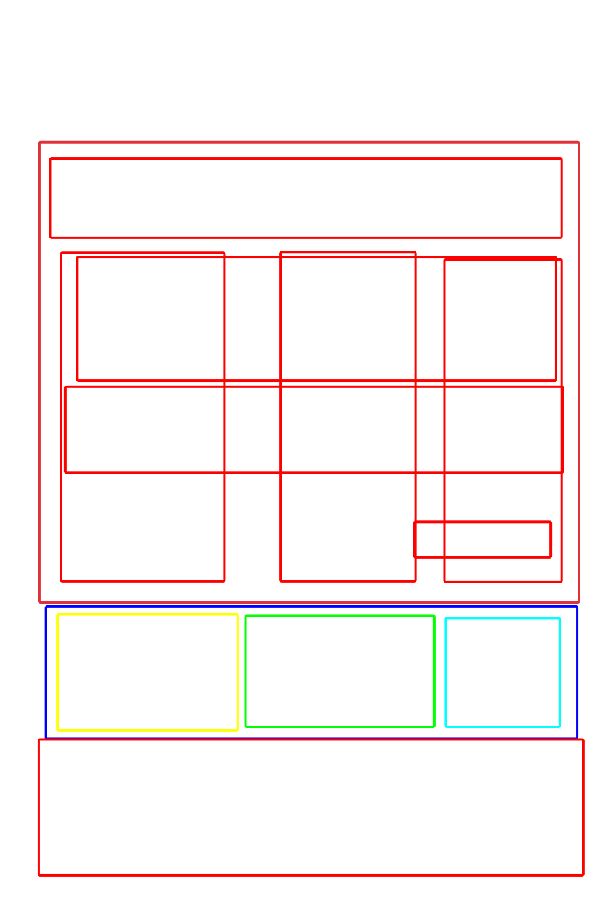

# La interfaz nueva: cómo se ve

Lectura: 4 min · 24 oct 2026 · Es solo el dibujo de la pantalla: todavía no está construida en la app.

**En resumen**
- Es una sola pantalla con 5 partes, de arriba abajo: la historia de todo el video, lo que pasa en la toma que elijas, las fotos de referencia, la fila de tomas y el prompt final.
- Las fotos son lo más grande, porque esta pantalla tiene que entrar por los ojos.
- **Lo nuevo:** la caja de fotos se parte en dos mitades. A la izquierda, en rojo, va **lo que no cambia** (Teto, un producto, un lugar). A la derecha, en azul, va **lo que se presta** (ropa, poses, efectos). Así tú decides qué se queda fijo y qué puede cambiar.
- **También lo nuevo:** varias fotos pueden ir juntas en una cajita que ocupa un solo lugar y que se abre para ver lo que hay dentro.

## De dónde salió

Tú dibujaste las cajas en el pizarrón:

Y así quedó la primera maqueta de la pantalla. Todavía no tiene la caja de fotos partida en dos; eso viene en la próxima versión:

Las dos juntas, con tu dibujo encima en tenue, para ver que siguen el mismo orden:

## Las 5 partes, de arriba abajo

### 1. Historia general
Una tira con la historia de **todo** el video. Tiene tres renglones:
- **Idea:** lo que tú escribiste, con tus palabras.
- **Arco:** qué cambia desde la primera toma hasta la última.
- **Luz y ambiente:** la hora, la luz y los colores de todo el edit.

Así el edit queda partido en dos: lo que vale para todo el video (aquí) y lo de cada toma (abajo).

### 2. Prompt de la toma
Una tira que al principio dice «Selecciona una toma para mostrar su prompt». Cuando tocas una toma de la fila de tomas, aquí aparece lo que esa toma le dice a H3.

### 3. Referencias: la caja de fotos, partida en dos

Es la caja más grande de la pantalla. Se parte por la mitad, como una mesa con dos lados: **el rojo a la izquierda y el azul a la derecha** (primero estaban al revés y los cambiamos).

**Mitad izquierda, roja: «lo que no cambia»**
- Aquí va quien tiene que ser **siempre igual** en todo el video: la cara, el pelo y el cuerpo de Teto, un producto, un objeto o un lugar que tiene que salir igual cada vez.
- Es como el muñeco protagonista: puede cambiarse de ropa o de sitio, pero siempre es el mismo muñeco.

**Mitad derecha, azul: «lo que se presta»**
- Aquí va lo que el protagonista **se pone o hace** solo en algunas tomas: la ropa (como la chaqueta de Vera), las poses, los efectos y cualquier otra referencia.
- Es como la caja de disfraces: el muñeco toma de aquí lo que le toca en cada toma.

**Por qué así:** porque ya probamos que funciona. Pusimos a Teto a la izquierda (sus 4 fotos juntas) y la ropa de Vera, con la cara borrosa, a la derecha. Salió Teto, con su cara y sus taladros, vestida como Vera:

**Las cajitas (grupos de fotos)**
- Puedes meter varias fotos en **una sola cajita**, como las 4 de Teto, y la cajita ocupa **un solo lugar** en la mitad que le toque.
- Si la abres, ves todas las fotos de dentro y puedes poner, quitar o cambiar fotos, igual que con los RefMods que juntan varias imágenes.
- Así la pantalla no se llena cuando un personaje tiene muchas fotos.

**Cómo se ven las fotos (en las dos mitades)**
- **Grandes y enteras:** cada foto se ve completa, sin recortes, para que se aprecien sus detalles. Recortarlas cortaba la inspiración.
- El espacio que sobra alrededor lo rellena la misma imagen, ampliada y borrosa en oscuro, para que no se vea vacío.
- **Abajo de cada foto** va una franja con su número (`<Picture 1>`) y para qué sirve, sin tapar la imagen.
- **Al tocar una toma,** se iluminan con un borde dorado las fotos que usa, en las dos mitades, y las demás se apagan un poco.

### 4. Línea de tiempo
Una fila de cajitas de colores, una por toma, como en cualquier editor de video.
- **El ancho de cada cajita es lo que dura su toma:** una toma larga es ancha y una corta es estrecha.
- Cada cajita dice su número, el lugar y sus segundos.
- **El botón +** añade una toma, y las demás se estrechan para dejarle sitio.

### 5. Prompt final
La caja de abajo del todo, con el prompt completo que recibe H3 después de pasar por el LLM. Las referencias (`<Picture N>`) se ven resaltadas, y arriba hay un botón «Generar con LLM».

## El pizarrón donde se diseña

- **Dónde:** http://100.66.189.56:8091, en el PC o en el celular, con Tailscale encendido.
- **Qué hace:** tú dibujas con lápiz, rectángulos y círculos, con o sin relleno, y los mueves y cambias de tamaño. Yo cambio la pantalla y te aparece sola en un par de segundos.
- **Tu dibujo nunca se borra por mis cambios:** va en una capa aparte. El botón «Dibujo: visible / tenue / oculto» te deja verlo, compararlo o esconderlo.
- **👆 Usar:** deja de dibujar para que puedas tocar la pantalla de prueba, por ejemplo elegir una toma.

## Lo que todavía no decidimos

- Si la caja de fotos se parte justo por la mitad o si una mitad puede ser más ancha que la otra.
- Cómo se crea una cajita: arrastrando fotos una encima de otra, o con un botón «agrupar».
- Dónde van los controles que ya tiene el editor del nodo: candados, fuerza de cada referencia, frase del efecto y regenerar una toma.

## Archivos

- **La pantalla de prueba:** `~/Escritorio/pizarron_app/interfaz.html`, con sus datos en `datos_maqueta.json` y las fotos en `img/`.
- **El pizarrón:** `index.html` y `servidor.py` en la misma carpeta.
- **Tu dibujo:** `dibujo.json` y `dibujo.svg`, con una copia en `dibujo_respaldo_usuario.*`.
- **La prueba de Teto con la ropa de Vera:** `~/Escritorio/experimentos_edit/edit_prompt_llm/prueba_teto_ropa_vera/`.
